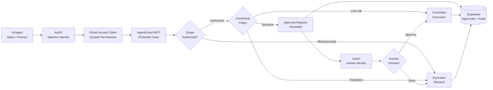
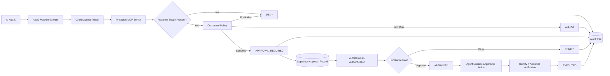

# AgentGuard

### Identity Security for AI Agents

AgentGuard is an identity-aware authorization layer for autonomous AI agents.

It gives each agent its own machine identity, limits access with OAuth scopes, evaluates contextual policy before sensitive actions execute, and introduces a separately authenticated human approval boundary when autonomous authority should stop.

**Live Product:**  
https://agentguard-eight.vercel.app

**MCP Authorization Backend:**  
https://github.com/haisamar/agentguard-mcp

---

## The Problem

AI agents are increasingly being connected to real systems:

- CRMs
- financial tools
- support platforms
- internal APIs
- databases
- MCP servers

But connecting an agent to a tool creates a security question:

> Just because an agent can authenticate, should it be allowed to do everything the tool supports?

Usually, no.

A sales agent may need to:

```text
read CRM accounts
update opportunities
inspect support context
```

but it should not automatically be able to:

```text
issue refunds
export customer data
modify security settings
```

And even a finance agent that legitimately has refund permissions may need human approval before issuing a high-value refund.

AgentGuard demonstrates how identity, authorization, contextual policy, and human control can be layered together around AI agent execution.

---

# What AgentGuard Does

AgentGuard separates authorization into multiple security boundaries:

```text
AI Agent
   ↓
Machine Identity
   ↓
OAuth Scope Authorization
   ↓
Contextual Policy
   ↓
Human Approval if Required
   ↓
Controlled Execution
   ↓
Audit Trail
```

Authentication alone does not imply unlimited authority.

---

# Live Demo

The public demo can be explored without authentication:

**https://agentguard-eight.vercel.app/demo**

It contains three real persisted authorization scenarios.

---

## Scenario 1 — Human Approved

A Finance Agent requests a `$750` refund.

```text
Finance Agent
      ↓
Authenticated machine identity
      ↓
finance:refund scope verified
      ↓
Refund exceeds $500 autonomous threshold
      ↓
APPROVAL_REQUIRED
      ↓
Authenticated human administrator approves
      ↓
Finance Agent executes approved refund
      ↓
ALLOW
```

Final state:

```text
EXECUTED
```

---

## Scenario 2 — Human Denied

The same Finance Agent requests another `$750` refund.

The agent has the correct OAuth permission, so the request passes the scope check.

However, contextual policy requires human approval.

```text
Finance Agent
      ↓
finance:refund ✓
      ↓
Refund > $500
      ↓
APPROVAL_REQUIRED
      ↓
Human Administrator
      ↓
DENY
      ↓
Finance Agent attempts execution
      ↓
DENY
```

Final state:

```text
DENIED
```

This demonstrates that:

> Being authorized to request an action does not necessarily mean the agent is authorized to execute it autonomously.

---

## Scenario 3 — Scope Blocked

A Sales Agent attempts to issue a refund.

Its identity contains:

```text
crm:read
crm:write
support:read
```

but the protected tool requires:

```text
finance:refund
```

AgentGuard blocks the request immediately.

```text
Sales Agent
      ↓
Authenticated
      ↓
Missing finance:refund
      ↓
DENY
```

Contextual policy is never evaluated.

Human review is never reached.

The request fails at the least-privilege authorization boundary.

---

# Architecture

# Architecture

AgentGuard separates machine authentication, least-privilege authorization, contextual risk decisions, and human approval so an authenticated AI agent never automatically receives unlimited authority.





---

# Identity Model

AgentGuard deliberately separates **machine identities** from **human identities**.

## Machine Identities

Each agent runtime receives a separate Auth0 Machine-to-Machine identity.

The demo contains three runtimes.

| Identity | Role | OAuth Scopes |
|---|---|---|
| Sales Agent | Revenue Operations | `crm:read`, `crm:write`, `support:read` |
| Finance Agent | Finance Operations | `crm:read`, `finance:read`, `finance:refund` |
| Admin Runtime | Security Administration | `agent:manage` |

This prevents multiple agents from sharing one broadly privileged credential.

---

## Human Identity

Sensitive decisions are reviewed through a separately authenticated Auth0 user.

The human administrator is not the same identity as the requesting machine.

Example:

```text
Requested by
Finance Agent
Machine Identity

Reviewed by
Human Administrator
Human Identity
```

This creates a clear separation between:

```text
machine authority
```

and:

```text
human approval authority
```

---

# Authorization Model

AgentGuard uses layered authorization.

## 1. Authentication

Auth0 establishes the identity of the calling agent.

The MCP server receives an OAuth access token containing the machine identity.

---

## 2. OAuth Scope Authorization

Each protected MCP tool declares the permission required to call it.

Example:

```text
issue_refund
requires
finance:refund
```

If the agent does not have the required scope:

```text
DENY
```

No policy evaluation or human escalation is needed.

---

## 3. Contextual Policy

Passing an OAuth scope check does not automatically guarantee execution.

AgentGuard evaluates the context of the requested action.

Current demonstration rules include:

```text
Refund <= $500
→ ALLOW

Refund > $500
→ APPROVAL_REQUIRED

Customer data export
→ APPROVAL_REQUIRED

Customer deletion
→ DENY
```

This separates:

```text
Can this identity request this type of operation?
```

from:

```text
Should this exact operation execute autonomously?
```

---

## 4. Human-in-the-Loop Authorization

Sensitive operations are paused and persisted.

The protected administrator dashboard shows the pending request.

The authenticated human can then choose:

```text
Approve
```

or:

```text
Deny
```

The decision is persisted and added to the security audit trail.

---

## 5. Approval-Bound Execution

A human approval does not directly execute the action.

The original machine identity returns and requests execution.

AgentGuard then verifies:

```text
Does the approval exist?

Is it APPROVED?

Does the approval belong to this agent?

Does it match this action?

Has it already been executed?
```

Only then can execution continue.

---

## 6. Replay Protection

Successfully executed approvals transition to:

```text
EXECUTED
```

A second attempt to execute the same approval is blocked.

```text
EXECUTED
      ↓
second execution attempt
      ↓
DENY
```

The replay attempt is recorded as a security event.

---

# Administrator Console

The protected dashboard is available at:

```text
/dashboard
```

It requires Auth0 authentication.

The administrator console provides:

- machine identity inventory
- granted OAuth scopes
- authenticated human operator context
- pending approvals
- approve / deny controls
- authorization trace explorer
- security activity feed
- detailed audit-event inspection
- approval history
- machine vs human identity visualization

Raw identity and audit context remains behind authentication.

---

# Public Demo

The public demo exists separately at:

```text
/demo
```

It is intentionally read-only.

Before data reaches the browser, private security information is removed.

The public demo does **not** expose:

```text
Auth0 subject IDs
machine client IDs
administrator email addresses
OAuth access tokens
Supabase credentials
raw audit metadata
private approval identifiers
```

The public interface receives only sanitized scenario data.

---

# Authorization Trace Explorer

AgentGuard includes an interactive trace explorer that reconstructs persisted security scenarios.

Users can switch between:

```text
Human Approved
Human Denied
Scope Blocked
```

Each trace visualizes:

```text
01 Agent Identity

02 Scope Check

03 Contextual Policy

04 Human Review

05 Execution
```

This makes the authorization lifecycle understandable without needing access to the MCP Inspector, Auth0 dashboard, or database.

---

# Security Activity

Every important authorization decision is recorded as an audit event.

Example decisions include:

```text
ALLOW
DENY
APPROVAL_REQUIRED
APPROVED
```

Selecting an event opens a detailed security drawer containing information such as:

```text
Identity
Identity Type
Decision
Action
Required Scope
Reason
Approval Reference
Timestamp
Event ID
Security Metadata
```

Example authorization failure:

```text
Sales Agent

Action
issue_refund

Decision
DENY

Required Scope
finance:refund

Granted Scopes
crm:read
crm:write
support:read

Missing Scope
finance:refund

Security Event
authorization_failure
```

---

# Approval Lifecycle

Sensitive actions are represented by persisted approval records.

Available states:

```text
PENDING
APPROVED
DENIED
EXECUTED
```

Successful flow:

```text
PENDING
   ↓
APPROVED
   ↓
EXECUTED
```

Denied flow:

```text
PENDING
   ↓
DENIED
```

AgentGuard also separates:

```text
reviewed_by
```

from:

```text
approved_by
```

so a denied request can correctly represent:

```text
status      = DENIED
reviewed_by = Human Administrator
approved_by = null
```

---

# Technology

AgentGuard is built with:

### Identity & Authorization

```text
Auth0
OAuth 2.0
Machine-to-Machine Applications
Human Authentication
Scoped Access Tokens
```

### Agent Interface

```text
Model Context Protocol
FastMCP
```

### Backend

```text
Python
Starlette
Uvicorn
```

### Application

```text
Next.js 16
React
TypeScript
Tailwind CSS
```

### Persistence

```text
Supabase
PostgreSQL
Row Level Security
```

### Deployment

```text
Vercel
GitHub
```

---

# Repository Structure

```text
agentguard/
│
├── src/
│   ├── app/
│   │   ├── dashboard/
│   │   │   ├── ApprovalButtons.tsx
│   │   │   ├── SecurityActivity.tsx
│   │   │   ├── TraceExplorer.tsx
│   │   │   ├── actions.ts
│   │   │   ├── layout.tsx
│   │   │   └── page.tsx
│   │   │
│   │   ├── demo/
│   │   │   ├── PublicTraceExplorer.tsx
│   │   │   └── page.tsx
│   │   │
│   │   └── page.tsx
│   │
│   ├── lib/
│   │   ├── agentguard-data.ts
│   │   ├── auth0.ts
│   │   └── public-demo-data.ts
│   │
│   └── proxy.ts
│
├── package.json
└── README.md
```

The Python MCP authorization server is maintained separately:

**https://github.com/haisamar/agentguard-mcp**

---

# Backend MCP Server

The companion backend implements:

- Auth0 access-token validation
- protected-resource OAuth metadata
- MCP tool authorization
- required-scope enforcement
- contextual policy evaluation
- approval creation
- human approval enforcement
- approval-bound execution
- replay protection
- Supabase persistence
- security audit logging

Backend repository:

**https://github.com/haisamar/agentguard-mcp**

---

# MCP Tools

The current security prototype includes:

```text
search_accounts
issue_refund
list_pending_approvals
approve_action
execute_approved_refund
```

Example:

```text
Finance Agent
finance:refund
      ↓
issue_refund($100)
      ↓
ALLOW
```

versus:

```text
Finance Agent
finance:refund
      ↓
issue_refund($750)
      ↓
APPROVAL_REQUIRED
```

versus:

```text
Sales Agent
no finance:refund
      ↓
issue_refund($750)
      ↓
DENY
```

---

# Database Security

Approval and audit records live in Supabase/PostgreSQL.

Row Level Security is enabled on the underlying tables.

No public browser policies are intentionally defined for sensitive AgentGuard records.

Server-side components use protected environment credentials.

The Supabase secret key is never shipped to client-side JavaScript.

Public demo information is sanitized server-side before being passed to interactive client components.

---

# Local Development

## Requirements

```text
Node.js
Auth0 tenant
Supabase project
AgentGuard MCP backend
```

Clone:

```bash
git clone https://github.com/haisamar/agentguard.git
cd agentguard
```

Install:

```bash
npm install
```

Create:

```text
.env.local
```

with your own environment configuration.

Example variables:

```env
SUPABASE_URL=
SUPABASE_SECRET_KEY=

AUTH0_DOMAIN=
AUTH0_CLIENT_ID=
AUTH0_CLIENT_SECRET=
AUTH0_SECRET=

APP_BASE_URL=http://localhost:3000

AGENTGUARD_ADMIN_EMAIL=
```

Never commit `.env.local`.

Run:

```bash
npm run dev
```

Then open:

```text
http://localhost:3000
```

---

# Route Model

```text
/
Public product page

/demo
Public sanitized security demo

/dashboard
Auth0-protected administrator console
```

This separation allows the project to remain easily reviewable as a portfolio project without exposing privileged administrative functionality.

---

# Production

The frontend is deployed on Vercel:

**https://agentguard-eight.vercel.app**

Production authentication uses an Auth0 Regular Web Application with explicit production callback, logout, and origin URLs.

Secrets are stored as Vercel environment variables and are not committed to Git.

---

# Security Boundaries Demonstrated

AgentGuard demonstrates several identity-security concepts in one system:

### Authentication ≠ Authorization

An authenticated agent can still be denied.

### Least Privilege

Agents receive only the scopes their role requires.

### Context-Aware Authorization

Authorization can depend on details of the action, not just the caller.

### Separation of Duties

A machine can request an action while a human independently approves it.

### Human-in-the-Loop Control

Autonomous execution can stop at defined risk boundaries.

### Approval-Bound Execution

Approval is associated with the requesting identity and action.

### Replay Protection

Previously executed approvals cannot be reused.

### Auditability

Authorization decisions are persisted with identity and decision context.

### Public / Private Separation

Portfolio viewers can explore sanitized scenarios without gaining access to administrative data.

---

# What I Wanted to Explore

AgentGuard was built to explore a question:

> What does identity security look like when the user is not always a human?

Traditional application security often assumes that people authenticate and then interact with systems directly.

AI agents change that model.

Autonomous runtimes can:

```text
call APIs
use tools
modify records
trigger workflows
take financial actions
```

That makes identity and authorization increasingly important at the agent layer.

AgentGuard explores how familiar IAM concepts such as:

```text
machine identity
OAuth scopes
least privilege
separation of duties
human approval
auditability
```

can be applied to AI-agent execution.

---

# Current Scope

AgentGuard is a security portfolio prototype, not a production IAM product.

Some intentional boundaries include:

- contextual policies are currently defined in code
- machine identities are mapped to demonstration roles
- human administrator authorization currently uses an application-level allowlist
- policy management does not yet have its own control plane
- database audit records are not cryptographically immutable
- production distributed locking is outside the prototype scope
- MCP backend deployment is designed for controlled testing
- approval expiration is not currently implemented

These limitations are documented deliberately rather than hidden.

---

# Possible Extensions

Future versions could explore:

```text
Auth0 role-based administration
policy-as-code
policy versioning
agent identity registry
workload identity federation
delegated authorization
resource-level authorization
organization isolation
approval expiration
time-bound privileges
step-up authentication
signed audit events
SIEM integration
policy simulation
risk scoring
dynamic authorization
production MCP deployment
```

---

# Related Repository

### AgentGuard MCP

Python authorization server, policy engine, approval enforcement, and audit persistence:

https://github.com/haisamar/agentguard-mcp

---

# Live Project

### AgentGuard

https://agentguard-eight.vercel.app

### Interactive Demo

https://agentguard-eight.vercel.app/demo

### Administrator Console

```text
https://agentguard-eight.vercel.app/dashboard
```

Authentication required.