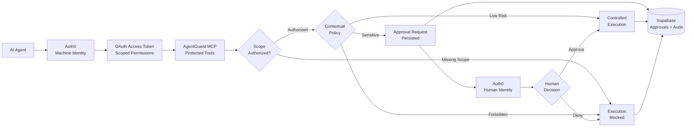

# AgentGuard

[](https://m8ven.ai/mcp/haisamar-agentguard-1w8g7f)

### Identity Security for AI Agents

AgentGuard is an identity-aware authorization layer for autonomous AI agents.

It gives each agent a distinct machine identity, limits what it can request using OAuth scopes, evaluates contextual policy before sensitive actions execute, introduces authenticated human approval when autonomous authority should stop, and records the resulting security decisions in an auditable trail.

**Live Product:**  
https://agentguard-eight.vercel.app

**Interactive Demo:**  
https://agentguard-eight.vercel.app/demo

**MCP Authorization Backend:**  
https://github.com/haisamar/agentguard-mcp

---

## The Problem

AI agents are increasingly connected to real systems:

- CRMs
- financial tools
- support platforms
- internal APIs
- databases
- MCP servers

Connecting an agent to a tool is easy.

The harder question is:

> Which agent should be allowed to use which tool, under what conditions, and when should a human have to intervene?

A Sales Agent may need to:

```text
read CRM accounts
update opportunities
inspect support context
```

but it should not automatically be able to:

```text
issue refunds
export customer data
modify security settings
```

Even a Finance Agent that legitimately has refund permission may still need human approval before issuing a high-value refund.

AgentGuard demonstrates how identity, authorization, contextual policy, human control, and auditability can be layered around autonomous AI execution.

---

# What AgentGuard Does

AgentGuard introduces multiple security boundaries around AI-agent actions.

```text
AI Agent
   ↓
Machine Identity
   ↓
OAuth Scope Authorization
   ↓
Contextual Policy
   ↓
Human Approval if Required
   ↓
Controlled Execution
   ↓
Audit Trail
```

The core principle is simple:

> Authentication does not imply unlimited authority.

---

# Security Lifecycle

```text
AI Agent
   ↓
Machine Identity
   ↓
OAuth Scope Authorization
   ↓
Contextual Policy
   ↓
 ┌───────────────┬───────────────────────┐
 │               │                       │
ALLOW            DENY            APPROVAL_REQUIRED
 │               │                       │
 ↓               ↓                       ↓
Execute          Block             Human Review
                                         │
                                  Approve / Deny
                                         │
                                         ↓
                               Controlled Execution
                                         │
                                         ↓
                                    Audit Trail
```

AgentGuard separates:

```text
Who is calling?
```

from:

```text
What are they allowed to request?
```

from:

```text
Should this exact action execute autonomously?
```

from:

```text
Does a human need to approve it?
```

---

# Public Demo

The public AgentGuard demo is available without authentication:

https://agentguard-eight.vercel.app/demo

The demo is intentionally deterministic.

It does **not** expose private Supabase security records, Auth0 subjects, machine client IDs, access tokens, private approval IDs, or administrator information.

Instead, it simulates the AgentGuard security lifecycle in the browser so reviewers can understand the system immediately.

The simulation demonstrates four scenarios.

---

## Scenario 1 — Scope Blocked

A Sales Agent attempts to issue a `$750` refund.

The Sales Agent has:

```text
crm:read
crm:write
support:read
```

The refund operation requires:

```text
finance:refund
```

AgentGuard therefore stops the request immediately.

```text
Sales Agent
   ↓
Authenticated Machine Identity
   ↓
issue_refund
   ↓
Required Scope
finance:refund
   ↓
Scope Missing
   ↓
DENY
```

Contextual policy is never evaluated.

Human review is never reached.

The request fails at the least-privilege authorization boundary.

---

## Scenario 2 — Autonomous Allow

A Finance Agent requests a `$100` refund.

The Finance Agent has:

```text
finance:refund
```

The request therefore passes OAuth authorization.

The contextual policy then evaluates the amount.

```text
Finance Agent
   ↓
Authenticated Machine Identity
   ↓
finance:refund
   ↓
Scope Granted
   ↓
Refund = $100
   ↓
Within Autonomous Threshold
   ↓
ALLOW
   ↓
Execute
```

This demonstrates that properly authorized low-risk operations can execute autonomously.

---

## Scenario 3 — Human Approval Required

A Finance Agent requests a `$750` refund.

The agent has the correct OAuth permission:

```text
finance:refund
```

so authorization succeeds.

However, AgentGuard policy requires human approval for refunds above `$500`.

```text
Finance Agent
   ↓
Authenticated Machine Identity
   ↓
finance:refund
   ↓
Scope Granted
   ↓
Refund = $750
   ↓
Contextual Policy
   ↓
APPROVAL_REQUIRED
   ↓
Wait for Human Review
```

The agent is authorized to request the operation, but not authorized to execute it autonomously.

---

## Scenario 4 — Human Approved Execution

An authenticated Human Administrator reviews the pending `$750` refund.

```text
Human Administrator
   ↓
Authenticated Human Identity
   ↓
Review Sensitive Action
   ↓
APPROVE
```

The approval does not directly execute the refund.

Instead, the original Finance Agent returns and requests execution.

```text
Finance Agent
   ↓
Approval Verified
   ↓
Identity Verified
   ↓
Action Verified
   ↓
Replay Check
   ↓
EXECUTED
```

This creates a separation between:

```text
Machine authority
```

and:

```text
Human approval authority
```

---

# Public Technical Trace Explorer

The public demo also includes a technical trace explorer.

It visualizes the security decision pipeline behind the simulation.

Typical stages include:

```text
01 Agent Identity

02 Scope Check

03 Contextual Policy

04 Human Review

05 Execution
```

The trace explorer helps reviewers understand how AgentGuard connects:

- identity
- authorization
- policy
- approval
- execution
- audit concepts

without requiring access to Auth0, Supabase, MCP Inspector, or the protected administrator dashboard.

---

# Administrator Console

The protected AgentGuard administrator console is available at:

```text
/dashboard
```

Production URL:

```text
https://agentguard-eight.vercel.app/dashboard
```

Authentication is required.

The administrator console is intentionally separate from the public simulation.

Unlike the public demo, the admin console displays persisted AgentGuard security data stored in Supabase.

It provides:

- machine identity inventory
- granted OAuth scopes
- authenticated human operator context
- pending approval queue
- approve / deny controls
- persisted authorization traces
- security activity feed
- detailed audit-event inspection
- approval history
- machine vs human identity visualization

---

# Machine Identities

AgentGuard deliberately assigns separate machine identities to different autonomous runtimes.

The demonstration environment contains three machine roles.

| Identity | Role | OAuth Scopes |
|---|---|---|
| Sales Agent | Revenue Operations | `crm:read`, `crm:write`, `support:read` |
| Finance Agent | Finance Operations | `crm:read`, `finance:read`, `finance:refund` |
| Admin Runtime | Security Administration | `agent:manage` |

This prevents multiple agents from sharing one broadly privileged credential.

A Sales Agent cannot issue refunds simply because a Finance Agent can.

---

# Human Identity

Sensitive decisions are reviewed using a separately authenticated human identity through Auth0.

Example:

```text
Requested By
Finance Agent
Machine Identity

Reviewed By
Human Administrator
Human Identity
```

The requesting machine and approving human are intentionally different security principals.

---

# Architecture



---

# Authorization Model

AgentGuard applies authorization in layers.

---

## 1. Authentication

Auth0 establishes the identity of the calling agent.

Machine runtimes authenticate using Auth0 Machine-to-Machine applications.

Human administrators authenticate separately using a normal Auth0 web application.

Authentication answers:

```text
Who is this caller?
```

It does not answer:

```text
Should this caller be allowed to perform this action?
```

---

## 2. OAuth Scope Authorization

Protected MCP tools declare which OAuth scope is required.

Example:

```text
issue_refund
requires
finance:refund
```

If the caller does not possess the required scope:

```text
DENY
```

Execution stops immediately.

No contextual policy evaluation is necessary.

No human approval is requested.

---

## 3. Contextual Policy

Passing OAuth authorization does not automatically guarantee execution.

AgentGuard evaluates the context of the requested operation.

Current demonstration rules include:

```text
Refund <= $500
→ ALLOW

Refund > $500
→ APPROVAL_REQUIRED

Customer data export
→ APPROVAL_REQUIRED

Customer deletion
→ DENY
```

This separates two different security questions.

```text
Can this identity request this type of operation?
```

and:

```text
Should this exact operation execute autonomously?
```

---

## 4. Human-in-the-Loop Authorization

Sensitive operations are persisted and paused.

A separately authenticated human can then:

```text
APPROVE
```

or:

```text
DENY
```

the request.

The human decision becomes part of the approval lifecycle and audit trail.

---

## 5. Approval-Bound Execution

Human approval does not directly mean:

```text
execute immediately
```

Instead, the original machine identity must return and request execution.

AgentGuard verifies:

```text
Does the approval exist?

Is it APPROVED?

Does the approval belong to this machine identity?

Does the approval match this action?

Has it already been executed?
```

Only then can execution continue.

---

## 6. Replay Protection

Successful approvals transition through:

```text
PENDING
   ↓
APPROVED
   ↓
EXECUTED
```

Once an approval becomes:

```text
EXECUTED
```

it cannot be reused.

A second execution attempt is rejected.

---

# Approval Lifecycle

AgentGuard approval records support:

```text
PENDING
APPROVED
DENIED
EXECUTED
```

Successful flow:

```text
PENDING
   ↓
APPROVED
   ↓
EXECUTED
```

Denied flow:

```text
PENDING
   ↓
DENIED
```

AgentGuard separates review information from approval information.

This means a denied request can correctly represent:

```text
status       = DENIED
reviewed_by  = Human Administrator
approved_by  = null
```

without incorrectly describing the human reviewer as approving the request.

---

# Security Activity

Every important authorization decision can be persisted as an audit event.

Example decisions include:

```text
ALLOW
DENY
APPROVAL_REQUIRED
APPROVED
```

The dashboard Security Activity feed displays persisted events and allows an administrator to inspect their context.

The event drawer can display:

```text
Identity
Identity Type
Action
Decision
Required Scope
Reason
Approval Reference
Timestamp
Event ID
Metadata
```

---

# Example Authorization Failure

A Sales Agent refund attempt may generate an event similar to:

```json
{
  "identity": "Sales Agent",
  "action": "issue_refund",
  "decision": "DENY",
  "required_scope": "finance:refund",
  "reason": "Missing required OAuth scope: finance:refund",
  "metadata": {
    "granted_scopes": [
      "crm:read",
      "crm:write",
      "support:read"
    ],
    "missing_scopes": [
      "finance:refund"
    ],
    "security_event": "authorization_failure"
  }
}
```

Secrets and access tokens should never be written into the audit log.

---

# Persisted Demo Data

The protected administrator dashboard can be populated with deterministic backend demonstration records.

The backend simulator demonstrates:

```text
Sales Agent
$750 refund
missing finance:refund
→ DENY
```

```text
Finance Agent
$100 refund
finance:refund granted
policy satisfied
→ ALLOW
```

```text
Finance Agent
$750 refund
finance:refund granted
→ APPROVAL_REQUIRED
→ Human Administrator approves
→ Finance Agent executes
→ EXECUTED
```

```text
Finance Agent
$900 refund
→ APPROVAL_REQUIRED
→ PENDING
```

These records are separate from the public simulation.

---

# Public / Private Separation

AgentGuard deliberately separates the public product experience from sensitive security data.

## Public Demo

The browser receives deterministic showcase data.

It does not expose:

```text
Auth0 subject IDs
machine client IDs
administrator emails
OAuth access tokens
Supabase credentials
private approval identifiers
raw security metadata
```

## Protected Dashboard

The authenticated administrator dashboard can access persisted:

```text
approvals
audit events
machine identities
human review context
```

using server-side credentials.

---

# Technology

## Identity & Authorization

```text
Auth0
OAuth 2.0
Machine-to-Machine Applications
Scoped Access Tokens
Human Authentication
```

## Agent Interface

```text
Model Context Protocol
FastMCP
```

## Backend

```text
Python
Starlette
Uvicorn
```

## Frontend

```text
Next.js 16
React
TypeScript
Tailwind CSS
```

## Persistence

```text
Supabase
PostgreSQL
Row Level Security
```

## Deployment

```text
Vercel
GitHub
```

---

# Repository Structure

```text
agentguard/
│
├── src/
│   ├── app/
│   │
│   │   ├── dashboard/
│   │   │   ├── ApprovalButtons.tsx
│   │   │   ├── SecurityActivity.tsx
│   │   │   ├── TraceExplorer.tsx
│   │   │   ├── actions.ts
│   │   │   ├── layout.tsx
│   │   │   └── page.tsx
│   │   │
│   │   ├── demo/
│   │   │   ├── AgentOverview.tsx
│   │   │   ├── DemoContext.tsx
│   │   │   ├── ProblemSection.tsx
│   │   │   ├── PublicTraceExplorer.tsx
│   │   │   ├── SecurityEventStream.tsx
│   │   │   ├── SecurityLifecycle.tsx
│   │   │   ├── SimulationRunner.tsx
│   │   │   ├── scenarios.ts
│   │   │   └── page.tsx
│   │   │
│   │   └── page.tsx
│   │
│   ├── lib/
│   │   ├── agent-identities.ts
│   │   ├── agentguard-data.ts
│   │   ├── auth0.ts
│   │   └── public-demo-data.ts
│   │
│   └── proxy.ts
│
├── package.json
└── README.md
```

The Python MCP authorization backend is maintained separately:

https://github.com/haisamar/agentguard-mcp

---

# Route Model

```text
/
Public product page

/demo
Public deterministic security simulation

/dashboard
Auth0-protected administrator console
```

The production build therefore separates publicly reviewable functionality from privileged administrative functionality.

---

# Local Development

## Requirements

- Node.js
- Auth0 tenant
- Supabase project
- AgentGuard MCP backend

Clone:

```bash
git clone https://github.com/haisamar/agentguard.git
cd agentguard
```

Install dependencies:

```bash
npm install
```

Create:

```text
.env.local
```

Example:

```env
SUPABASE_URL=
SUPABASE_SECRET_KEY=

AUTH0_DOMAIN=
AUTH0_CLIENT_ID=
AUTH0_CLIENT_SECRET=
AUTH0_SECRET=

APP_BASE_URL=http://localhost:3000

AGENTGUARD_ADMIN_EMAIL=
```

Never commit `.env.local`.

Start the application:

```bash
npm run dev
```

Open:

```text
http://localhost:3000
```

---

# Production Build

Run:

```bash
npm run build
```

Current route model:

```text
/            static
/demo        static
/dashboard   dynamic / authenticated
```

---

# Production Deployment

The frontend is deployed on Vercel:

https://agentguard-eight.vercel.app

Production authentication uses Auth0 with explicit production callback, logout, and origin configuration.

Secrets are stored using deployment environment variables and are never committed to Git.

---

# Security Boundaries Demonstrated

AgentGuard demonstrates several identity-security concepts in one system.

### Authentication ≠ Authorization

An authenticated agent can still be denied.

### Least Privilege

Agents receive only the OAuth scopes required for their role.

### Context-Aware Authorization

Authorization can depend on the context of the action.

### Separation of Duties

A machine requests an operation while a human independently approves it.

### Human-in-the-Loop Control

Autonomous execution stops at defined risk boundaries.

### Approval-Bound Execution

Human approval is tied to the original identity and requested action.

### Replay Protection

Previously executed approvals cannot be reused.

### Auditability

Authorization decisions are persisted with identity and decision context.

### Public / Private Separation

Portfolio viewers can explore the security model without receiving access to privileged data.

---

# Project Motivation

AgentGuard was built around a question:

> What does identity security look like when the user is not always a human?

Traditional application security often assumes that a person authenticates and then directly interacts with software.

AI agents change that model.

Autonomous runtimes can:

```text
call APIs
use tools
modify records
trigger workflows
take financial actions
```

That makes machine identity and authorization increasingly important.

AgentGuard explores how familiar IAM concepts such as:

```text
machine identity
OAuth scopes
least privilege
separation of duties
human approval
auditability
```

can be applied to AI-agent execution.

---

# Current Scope

AgentGuard is a security portfolio prototype rather than a production IAM platform.

Intentional boundaries currently include:

- contextual policy is defined in code
- machine identities are mapped to demonstration roles
- human administrator access currently uses an application-level allowlist
- policy management does not have a dedicated control plane
- approval expiration is not implemented
- audit records are not cryptographically immutable
- distributed locking for production concurrency is outside the current scope
- the MCP backend is intended for controlled testing

These boundaries are documented deliberately rather than hidden.

---

# Possible Extensions

Future versions could explore:

- Auth0 role-based administrator authorization
- policy-as-code
- policy versioning
- agent identity registry
- workload identity federation
- delegated authorization
- resource-level authorization
- organization isolation
- approval expiration
- time-bound privileges
- step-up authentication
- signed audit events
- SIEM integration
- policy simulation
- risk scoring
- dynamic authorization
- production MCP deployment
- additional MCP tools and resource servers

---

# Related Repository

## AgentGuard MCP

Python MCP authorization server, policy engine, approval enforcement, identity checks, replay protection, and audit persistence:

https://github.com/haisamar/agentguard-mcp

---

# Live Project

### AgentGuard

https://agentguard-eight.vercel.app

### Interactive Demo

https://agentguard-eight.vercel.app/demo

### Administrator Console

```text
https://agentguard-eight.vercel.app/dashboard
```

Authentication required.
