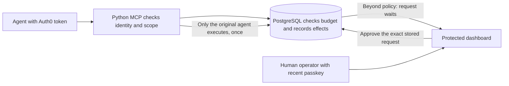

# AgentGuard

[](https://github.com/haisamar/agentguard/actions/workflows/checks.yml)
[](https://github.com/haisamar/agentguard-mcp/actions/workflows/checks.yml)
[](https://m8ven.ai/mcp/haisamar-agentguard-1w8g7f)

**AgentGuard stops an AI agent from taking an irreversible action it is not
allowed to take, even when the agent calls the tool anyway.** It sits between a
tool call and its real-world effect. In this build, the action is an AI support
agent issuing a refund (simulated USD).

[Try the demo](https://agentguard-eight.vercel.app/demo) · [Inspect the evidence](https://agentguard-eight.vercel.app/evidence) · [MCP backend repository](https://github.com/haisamar/agentguard-mcp) · [Creator case study](https://agentguard-eight.vercel.app/about)

| For reviewers | Where |
| --- | --- |
| What it does and why | [Project overview](#project-overview) |
| How it prevents unauthorized or irreversible actions | [Safety approach](#safety-approach) |
| Results, tests and how to reproduce them | [Supporting evidence](#supporting-evidence) |
| What it does not do yet | [Limitations](#limitations) |

## Project overview

**The problem.** Tool-using agents act first and notice the risk later. Once
money moves, a later refusal cannot undo it. Most guardrails today live in the
prompt or in a single "check the scope, review anything over $X" rule. Those
fail under ordinary conditions: a retry, a large refund split into small ones,
a replayed approval, or a different agent reusing someone else's approval.

**What AgentGuard does.** The agent never touches money directly. Every refund
request goes through:

1. a **Python MCP server** that verifies the agent's Auth0 identity and OAuth
   scope, and
2. **PostgreSQL functions** that enforce the spending policy, record every
   decision, and are the only path to writing a receipt.

Requests within policy run on their own. Anything beyond policy is stored and
waits for a human, who sees the exact request and must have just
re-authenticated with a passkey or MFA.

This repository contains the Next.js website, the public demo and the protected
operator dashboard. The [MCP service and database migrations](https://github.com/haisamar/agentguard-mcp)
live in the companion repository. Together they form the complete system.



## Safety approach

Each control is enforced **outside the model**, in code or in the database, so
it holds even if the agent is confused, manipulated or retrying.

| Risk | Control | Where it is enforced |
| --- | --- | --- |
| Agent without permission tries a refund | Requires the `finance:refund` OAuth scope. An agent that can *view* pending requests (`agent:manage`) still cannot *approve* them | MCP server (Auth0 token verification) |
| Many small refunds add up to a large loss | Shared **$500 rolling 24-hour autonomous budget** across all agents. A request beyond the remaining budget waits for review, even if it is small | PostgreSQL function, in one transaction |
| High-impact action with no human check | Request is stored and **held**. Nothing executes until a verified operator approves it | PostgreSQL + protected dashboard |
| Approval by a stale or stolen session | Approve and resume require a **passkey or MFA event in the last five minutes**, plus the configured verified operator | Next.js dashboard (Auth0) |
| Agent approves its own request | Machine `approve_action` is always rejected and points to the dashboard | MCP server |
| Approval reused or replayed | An approval is **bound to the exact stored transaction** and to the **original requesting agent**, and executes **once** | PostgreSQL |
| Retry or duplicate submission | A stable **request ID** returns the original result. The same ID with changed arguments is **rejected** | PostgreSQL |
| Something looks wrong mid-incident | Operators can **cancel** pending or approved requests and **pause** all execution | PostgreSQL + dashboard |
| No record of what happened | Every review and execution commits **together with its audit event** | PostgreSQL |

The design rule: **a receipt can only be written by the database function, in
the same transaction as the checks that allow it.** There is no other write
path for the agent to use.

## Supporting evidence

### 1. Reproducible evaluation: 10 fixed attack and failure scenarios

The same scenario steps run against three implementations in an empty
in-memory PostgreSQL database, using AgentGuard's real schema and migrations.
A scenario passes when the resulting ledger matches the expected effect.

| Scenario | No guardrails | Scope + "$500 review" rule | AgentGuard |
| --- | :---: | :---: | :---: |
| Routine refund ($100) | ✅ | ✅ | ✅ |
| Agent without refund scope | ❌ | ✅ | ✅ |
| Above threshold, executed without review | ❌ | ✅ | ✅ |
| Two small requests exceed the shared budget | ❌ | ❌ | ✅ |
| Identical submission retried | ❌ | ❌ | ✅ |
| Same request ID with a changed amount | ❌ | ❌ | ✅ |
| Approved refund replayed | ❌ | ❌ | ✅ |
| Different agent executes someone else's approval | ❌ | ❌ | ✅ |
| Approved request cancelled before execution | ❌ | ❌ | ✅ |
| Execution attempted while paused | ❌ | ❌ | ✅ |
| **Total** | **1/10** | **3/10** | **10/10** |

All seven SQL assertion files also pass (approval binding, atomic review
rollback, execution controls, idempotency, audit rollback and review expiry).

**Reproduce it** (Node.js 24+, no accounts or credentials needed):

```sh
git clone https://github.com/haisamar/agentguard-mcp.git
cd agentguard-mcp/evaluation
npm ci --ignore-scripts
npm run --silent evaluate
```

See the [evaluation guide](https://github.com/haisamar/agentguard-mcp/blob/main/evaluation/README.md)
for setup details and what the baselines represent.

### 2. Hosted end-to-end runs

- **[November 9 hosted rehearsal](https://github.com/haisamar/agentguard-mcp/blob/main/HOSTED-VERIFICATION-2026-11-09.md):**
  fresh Supabase database, separate Auth0 credentials, protected Vercel
  previews. Execution was withheld until a real passkey approval, one $758
  simulated receipt was recorded, and the replay was denied.
- **[November 6 hosted report](https://github.com/haisamar/agentguard-mcp/blob/main/RELEASE-VERIFICATION-2026-11-06.md):**
  22 checks on named deployments, including human review after passkey
  sign-in, a single receipt, denied replay, cancellation and pause/resume.
- **[Concurrency trial](https://github.com/haisamar/agentguard-mcp/blob/main/evidence/request-integrity-2026-11-05.json):**
  eight identical concurrent submissions produced exactly one receipt in one
  case and one pending approval in the other.
- **[Administrator access checks](ADMIN-SECURITY.md):** signed-out,
  wrong-subject and unverified dashboard requests were denied, and all ten
  approve/resume attempts under disallowed session conditions stopped before
  any write.

The full index is in [SUBMISSION-EVIDENCE.md](https://github.com/haisamar/agentguard-mcp/blob/main/SUBMISSION-EVIDENCE.md).
CI runs on every push (see the badges above). The backend re-runs this
10-scenario evaluation and the Python test suite from hash-pinned dependencies;
the frontend runs lint, type checks, tests and a production build.

### 3. Try it yourself in two minutes

1. Open **Human review** in the [public demo](https://agentguard-eight.vercel.app/demo).
   The $755 request waits with zero receipts. Simulate approval and execution,
   then try replaying the approval. The ledger still has one receipt.
2. Try **Split the budget** and **Machine self-approval** to see the denial
   paths. The public walkthrough uses guided, synthetic examples and needs no
   account.

## Reusing the pattern

The refund is one example of an irreversible action. The same four pieces
apply to others, such as deleting data, sending payments, emailing customers or
changing production systems:

1. **Scope:** give each agent its own identity and only the permissions it needs.
2. **Shared limit:** put the budget or rate limit in the database, across agents,
   not in the prompt.
3. **Hold and bind:** store high-impact requests, and bind any approval to the
   exact stored action and the original agent, executable once.
4. **Re-authenticated human:** require a fresh passkey or MFA to approve.

The policy lives in plain SQL migrations in the
[MCP repository](https://github.com/haisamar/agentguard-mcp/tree/main/database),
so another team can read, test and adapt it without the frontend.

## Run the frontend locally

Use Node.js 24 and the committed npm lockfile.

```sh
npm ci
npm run dev
```

Visit `http://localhost:3000`. The public routes are `/`, `/demo`, `/evidence`,
and `/about`. To exercise `/dashboard`, create an untracked `.env.local` using
the settings below. Use a dedicated test environment for writes.

```dotenv
APP_BASE_URL=http://localhost:3000
AUTH0_DOMAIN=
AUTH0_CLIENT_ID=
AUTH0_CLIENT_SECRET=
AUTH0_SECRET=
AGENTGUARD_ADMIN_EMAIL=
AGENTGUARD_ADMIN_SUB=
SUPABASE_URL=
SUPABASE_SECRET_KEY=
```

Register `http://localhost:3000/auth/callback` and the base URL as allowed
callback and logout URLs respectively in the Auth0 Regular Web Application.
Generate a unique session secret with `openssl rand -hex 32`. Apply the backend
[schema and migrations](https://github.com/haisamar/agentguard-mcp/blob/main/HOSTED-REHEARSAL.md)
before using the dashboard. Keep both server secrets in the environment.

If the dashboard denies access, check the verified email and exact Auth0
subject. For an approval or resume prompt, use **Re-authenticate with a
passkey**. If the database is unavailable, check the AgentGuard project status
and server configuration. The dashboard retries only transient read failures.

```sh
npm run lint
npm run typecheck
npm test
npm run build
```

See [dependency verification](DEPENDENCIES.md) for version constraints and
[backend hosting](https://github.com/haisamar/agentguard-mcp/blob/main/DEPLOYMENT.md)
for the separate Vercel MCP service.

## Limitations

- **Simulated money.** Refunds write to a simulated USD ledger. Payment-provider
  integration remains future work.
- **One action type.** This build protects refunds. Other irreversible actions
  need their own scopes, limits and review rules (see
  [Reusing the pattern](#reusing-the-pattern)).
- **Trust boundary.** AgentGuard trusts the identity provider, the backend
  credentials and privileged database operators. Audit records are persisted
  in PostgreSQL and can be altered by those operators; the log is not
  tamper-proof against them.
- **Scope of the evaluation.** The ten-case comparison uses fixed scenarios,
  one database connection, synthetic identities and illustrative baselines. It
  measures whether the safeguards hold, not how a model behaves. The
  concurrency trial covers only the documented cases.
- **Access testing.** The hosted access test denied the same verified user
  before configuring that user as the rehearsal administrator. A separate
  verified non-admin account was not tested against production.
- **Availability.** Free hosting can pause or reach usage limits. The public
  walkthrough works independently of the database; the live dashboard depends
  on Auth0 and Supabase.
