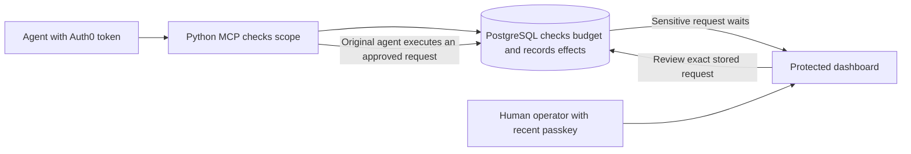

# AgentGuard

[](https://m8ven.ai/mcp/haisamar-agentguard-1w8g7f)

AgentGuard lets an AI support agent request a simulated refund while enforcing
OAuth permissions, a shared spending budget, and human review at the point of
execution. This repository contains the Next.js site and protected operator
dashboard. The [Python MCP service](https://github.com/haisamar/agentguard-mcp)
and PostgreSQL migrations live in the companion repository.

[Website](https://agentguard-eight.vercel.app) · [Try the demo](https://agentguard-eight.vercel.app/demo) · [Inspect the evidence](https://agentguard-eight.vercel.app/evidence) · [Creator case study](https://agentguard-eight.vercel.app/about)

## Review the project

1. Open **Human review** in the public demo and show the decision. The $755
   request waits with zero receipts. Simulate approval and execution, then try
   replaying the approval. The simulated ledger still has one receipt.
2. Try **Split the budget** and **Machine self-approval** to see different
   denial paths. The public walkthrough uses guided, synthetic examples.
3. Open the evidence page for the dated hosted report, which recorded one real
   human passkey approval, one simulated receipt, and denied replay. The separate
   credential-free evaluation matched expected ledger effects in 10 of 10 fixed
   scenarios. Each report describes its builds and limits.

The dashboard shows the stored transaction, expiry, budget, audit events, and
receipts. Access requires the configured Auth0 subject and verified email.
Approving or resuming also requires a passkey or MFA event in the last five
minutes. See [administrator configuration](ADMIN-SECURITY.md).



## Run the frontend locally

Use Node.js 24 and the committed npm lockfile.

```sh
npm ci
npm run dev
```

Visit `http://localhost:3000`. The public routes are `/`, `/demo`, `/evidence`,
and `/about`. To exercise `/dashboard`, create an untracked `.env.local` using
the settings below. Use a dedicated test environment for writes.

```dotenv
APP_BASE_URL=http://localhost:3000
AUTH0_DOMAIN=
AUTH0_CLIENT_ID=
AUTH0_CLIENT_SECRET=
AUTH0_SECRET=
AGENTGUARD_ADMIN_EMAIL=
AGENTGUARD_ADMIN_SUB=
SUPABASE_URL=
SUPABASE_SECRET_KEY=
```

Register `http://localhost:3000/auth/callback` and the base URL as allowed
callback and logout URLs respectively in the Auth0 Regular Web Application.
Generate a unique session secret with `openssl rand -hex 32`. Apply the backend
[schema and migrations](https://github.com/haisamar/agentguard-mcp/blob/main/HOSTED-REHEARSAL.md)
before using the dashboard. Keep both server secrets in the environment.

If the dashboard denies access, check the verified email and exact Auth0
subject. For an approval or resume prompt, use **Re-authenticate with a
passkey**. If the database is unavailable, check the AgentGuard project status
and server configuration. The dashboard retries only transient read failures.

```sh
npm run lint
npm run typecheck
npm test
npm run build
```

See [dependency verification](DEPENDENCIES.md) for version constraints and
[backend hosting](https://github.com/haisamar/agentguard-mcp/blob/main/DEPLOYMENT.md)
for the separate Vercel MCP service. The ledger uses simulated USD. The
application trusts the identity provider, backend credentials, and database
administrators. The evidence describes the specific tests performed.
